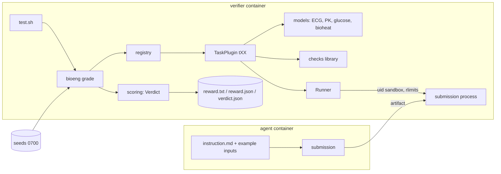
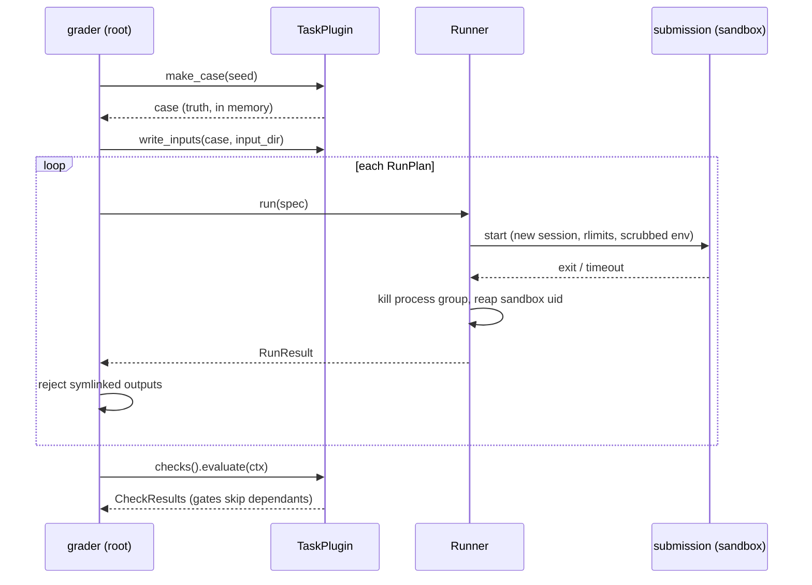
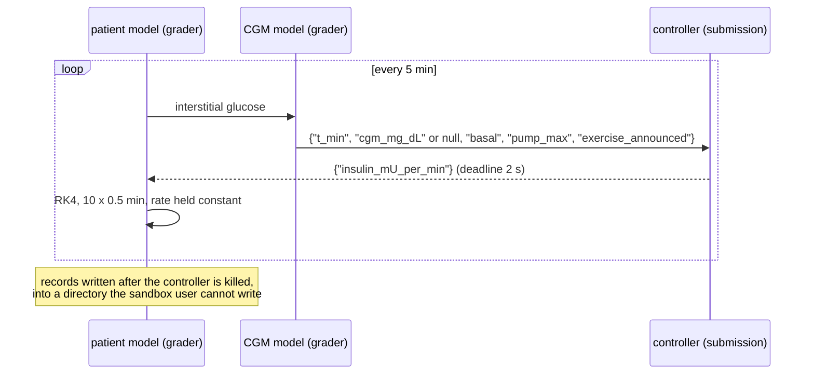
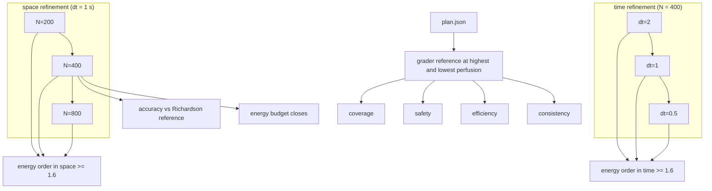
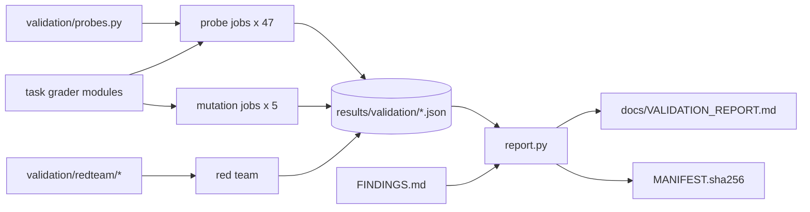
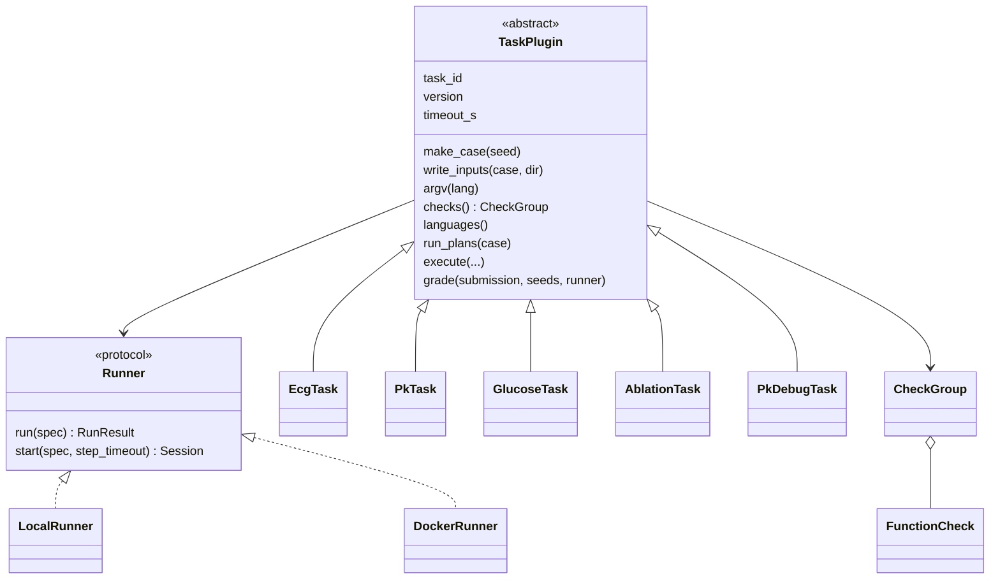

# Diagrams

Mermaid sources; GitHub renders them in place.

## Components

## Grading lifecycle (one case)

## t03 software in the loop

## t04 verification of the agent's solver

## Validation campaign (Snakemake)

## Task plugin class structure

